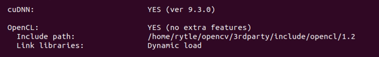

<div align="center">


</div>

# OpenCV with CUDA Support on Jetson (Build from Source)

Tested on: Jetson Orin Nano Developer Kit, JetPack 6.2.1 (L4T 36.4.7), CUDA 12.6, cuDNN 9.3, OpenCV 4.10.0.

## Table of Contents

- [Overview](#overview)
- [System Preparation](#1-system-preparation)
- [Install Required Dependencies](#2-install-required-dependencies)
- [Download OpenCV Source Code](#3-download-opencv-source-code)
- [Create Build Directory](#4-create-build-directory)
- [Configure Build with CUDA](#5-configure-build-with-cuda-cmake)
- [Add Swap Memory](#6-add-swap-memory-recommended)
- [Compile OpenCV](#7-compile-opencv)
- [Install OpenCV](#8-install-opencv)
- [Verify CUDA Support](#9-verify-cuda-support)
- [Runtime Verification](#10-runtime-verification-python)
- [Monitoring with jtop](#11-monitoring-with-jtop-optional)
- [Clean Up](#12-clean-up-optional)

  
## Overview

Pre-installed versions of OpenCV on Jetson devices often lack CUDA support.  
To enable GPU acceleration, OpenCV must be compiled from source with CUDA and cuDNN enabled.

This guide walks through the complete process of building OpenCV with CUDA support on a Jetson device.

---

## 1. System Preparation

Update the system:

```bash
sudo apt-get update && sudo apt-get upgrade -y
```

Check available disk space. About **15 GB free** is recommended (build files plus an 8 GB swap file):

```bash
df -h /
```

Install **jtop**, which you will use in step 5 to check your board's CUDA architecture:

```bash
sudo -H pip3 install -U jetson-stats
sudo reboot
```

## 2. Install Required Dependencies

Install all necessary libraries required for building OpenCV.

Important: Run the following command as a single block.
The backslashes (\) indicate line continuation.

```bash
sudo apt-get install -y build-essential cmake git unzip pkg-config \
    libjpeg-dev libpng-dev libtiff-dev \
    libavcodec-dev libavformat-dev libswscale-dev libv4l-dev \
    libxvidcore-dev libx264-dev \
    libgtk-3-dev libcanberra-gtk3-module \
    python3-dev python3-numpy \
    libtbb2 libtbb-dev \
    libopenblas-dev libatlas-base-dev gfortran \
    libhdf5-dev protobuf-compiler
```

## 3. Download OpenCV Source Code

Clone the official OpenCV repositories:

```bash
cd ~
git clone --branch 4.10.0 --depth 1 https://github.com/opencv/opencv.git
git clone --branch 4.10.0 --depth 1 https://github.com/opencv/opencv_contrib.git
```

`opencv` and `opencv_contrib` must always use the **same version**. `--depth 1` downloads
only that release instead of the full history, which is much faster.

## 4. Create Build Directory

```bash
cd ~/opencv
mkdir build
cd build
```

## 5. Configure Build with CUDA (CMake)

**First, find the `CUDA_ARCH_BIN` value for your Jetson.** Using the wrong value builds GPU code
your board cannot run. Check it in `jtop` (press `8` for INFO, then look at "CUDA Arch BIN"), or use this table:

| Jetson | CUDA_ARCH_BIN |
| --- | --- |
| Jetson Nano | 5.3 |
| Jetson TX2 | 6.2 |
| Jetson Xavier NX / AGX Xavier | 7.2 |
| Jetson Orin Nano / Orin NX / AGX Orin | 8.7 |

Then configure the build. Change `CUDA_ARCH_BIN="8.7"` if your board is not an Orin:

```bash
cmake -D CMAKE_BUILD_TYPE=RELEASE \
      -D CMAKE_INSTALL_PREFIX=/usr/local \
      -D OPENCV_EXTRA_MODULES_PATH=~/opencv_contrib/modules \
      -D ENABLE_NEON=ON \
      -D WITH_CUDA=ON \
      -D WITH_CUDNN=ON \
      -D OPENCV_DNN_CUDA=ON \
      -D CUDA_ARCH_BIN="8.7" \
      -D CUDA_FAST_MATH=ON \
      -D WITH_CUBLAS=ON \
      -D WITH_TBB=ON \
      -D BUILD_opencv_python3=ON \
      -D BUILD_opencv_python2=OFF \
      -D WITH_QT=OFF \
      -D WITH_GTK=ON \
      -D WITH_OPENGL=ON \
      -D OPENCV_GENERATE_PKGCONFIG=ON \
      -D BUILD_TESTS=OFF \
      -D BUILD_PERF_TESTS=OFF \
      -D BUILD_EXAMPLES=OFF ..
```

> **Important:** a backslash `\` only continues the command if it is the very last character
> on the line. A space after it breaks the command (you will see `-D: command not found`).

Before compiling, scroll up to the summary at the end of the output and check:

- `NVIDIA CUDA: YES`
- `NVIDIA GPU arch:` matches your `CUDA_ARCH_BIN` without the dot (for example `87` on Orin)
- `cuDNN: YES`
- the Python 3 section points to your Python 3 version (Python 3.10 on JetPack 6)

If cmake failed or ran with the wrong options, clean the build folder and run cmake again.
Only run this **inside `~/opencv/build`**, because it deletes everything in the current folder:

```bash
cd ~/opencv/build
rm -rf ./*
```

## 6. Add Swap Memory (Recommended)

Compiling CUDA code can run out of the Jetson's RAM and crash the build ("Killed").
An 8 GB swap file prevents this. It is created on whatever disk the system runs from
(check with `df -h /`), so make sure at least 8 GB is free.

```bash
sudo fallocate -l 8G /swapfile
sudo chmod 600 /swapfile
sudo mkswap /swapfile
sudo swapon /swapfile
echo '/swapfile none swap sw 0 0' | sudo tee -a /etc/fstab
free -h
```

> **Note:** On an NVMe SSD this works best. On an SD card it also works, but it is slower and
> heavy swap use wears the card faster. With limited space, use `4G` instead of `8G` and build
> with `make -j4`.

## 7. Compile OpenCV

> This step is resource-intensive and may take 1 to 2 hours.
> Ensure your device is properly cooled and powered.

Before starting:

- **Optional, faster build:** switch to the highest power mode, for example
  `sudo nvpmodel -m 2` (MAXN_SUPER on Orin Nano with JetPack 6.2).
- **Over SSH:** run the build inside `tmux` so it keeps going if the connection drops:
  `sudo apt install -y tmux`, then `tmux new -s opencv`. Detach with `Ctrl + B`, then `D`;
  reattach later with `tmux attach -t opencv`.

Then compile, from inside `~/opencv/build`:

```bash
make -j$(nproc)
```

- Lines starting with `warning:` are harmless; only `error:` stops the build.
- If the build stops with "Killed", continue with fewer parallel jobs: `make -j4`
- An interrupted build resumes where it stopped: just run `make -j$(nproc)` again.
- The build is finished when it reaches `[100%]` and your normal prompt returns.

## 8. Install OpenCV

```bash
sudo make install
sudo ldconfig
```

Run these **inside `~/opencv/build`**. The error `No rule to make target 'install'` means
you are in the wrong folder. `sudo ldconfig` prints nothing when it succeeds.

## 9. Verify CUDA Support

Check that OpenCV was built with CUDA (the filter keeps only the relevant lines):

```bash
python3 -c "import cv2; print(cv2.getBuildInformation())" | grep -iE "cuda|cudnn"
```

Look for:

```text
NVIDIA CUDA:  YES
cuDNN:        YES
```

Here's the confirmation output from a successful build:




## 10. Runtime Verification (Python)

Confirm Python uses your new build (not NVIDIA's original OpenCV):

```bash
python3 -c "import cv2; print(cv2.__version__, cv2.__file__); print('CUDA devices:', cv2.cuda.getCudaEnabledDeviceCount())"
```

Expected: `4.10.0`, a path under `/usr/local/...`, and `CUDA devices: 1`.
A path under `/usr/lib/...` with `4.8.0` means Python is still loading the original version.

Then confirm OpenCV actually runs code on the GPU:

```bash
python3 -c "import cv2, numpy as np; g=cv2.cuda_GpuMat(); g.upload(np.zeros((100,100),np.uint8)); r=cv2.cuda.threshold(g,1,255,cv2.THRESH_BINARY); print('GPU op OK')"
```

An error such as "no kernel image is available" means `CUDA_ARCH_BIN` was wrong for your board.

> **Note:** Do not uninstall NVIDIA's original OpenCV package; other JetPack components depend on it.
> Your build in `/usr/local` takes priority.

## 11. Monitoring with jtop (Optional)

jtop was installed in step 1. Run it to monitor the GPU:

```bash
jtop
```

This allows you to observe GPU utilization when running OpenCV applications. Press `q` to quit.

## 12. Clean Up (Optional)

After installing, the build folder can be removed to free several GB:

```bash
rm -rf ~/opencv/build
```

The installed OpenCV in `/usr/local` stays and keeps working.

## Result

If all steps are completed successfully, OpenCV will be fully accelerated using CUDA on your Jetson device.

## Who Is This For?

This guide is intended for:

- Developers working on NVIDIA Jetson platforms  
- Embedded systems engineers  
- Computer vision and AI/ML practitioners  
- Students and researchers building GPU-accelerated applications  

It is especially useful when the default OpenCV installation does not include CUDA support.

## Disclaimer

This project is an independent technical guide and is not affiliated with or endorsed by NVIDIA Corporation or the OpenCV project.

## License

This project is licensed under the MIT License.
